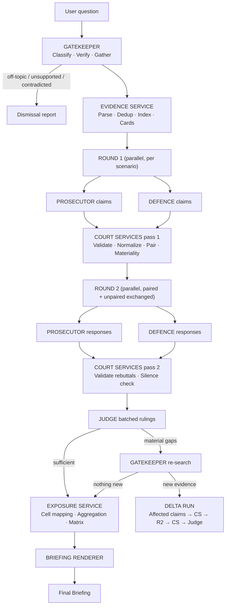

# Supply Chain Disruption Analyser — Architecture Plan

## 1. System Overview

Four autonomous agents argue over evidence. Deterministic services handle validation,
normalization, pairing, exposure calculation, and briefing rendering. No central planner.



---

## 2. Controlled Vocabularies

Defined in `app/vocabularies.py`. Used by Pydantic enums and agent prompts.

### Sectors (hierarchical, pair at parent)

```
energy
  energy.upstream         — exploration, production, crude export
  energy.refining         — refining, fuel production, bunkering
logistics
  logistics.shipping      — vessel operations, freight
  logistics.ports         — terminals, anchorage, transshipment
agriculture
  agriculture.farming     — crop production, livestock
  agriculture.processing  — food processing, packaging
chemicals
  chemicals.fertilizer    — urea, potash, nitrogen compounds
  chemicals.petrochemicals — polymers, plastics, intermediates
mining                    — mineral extraction, beneficiation
automotive                — vehicle manufacturing, parts
electronics               — semiconductors, components, assembly
pharmaceuticals           — drug manufacturing, API supply
```

Pairing uses the **parent** level. `energy.upstream` vs `energy.refining` → both `energy` → pair matches.

No `general` sector. Every claim must pick a specific sector.

### Commodities

`crude_oil` · `refined_fuels` · `natural_gas` · `lng` · `coal` · `urea` · `potash` · `iron_ore` · `soybeans` · `wheat` · `sugar` · `semiconductors` · `electronic_components` · `graphite` · `polymers`

**Related-values map** (for pairing, defined in `app/constants.py`):
`crude_oil ↔ refined_fuels`, `natural_gas ↔ lng`

If Prosecutor says `crude_oil` and Defence says `refined_fuels`, pairing treats them as related (pair matches).

No `OTHER` commodity. If the exact commodity isn't listed, extend the vocabulary before the run.

### Countries

ISO 3166-1 alpha-2. The full list covers the document pool:

`RU` `IR` `AE` `TR` `BR` `CN` `IN` `US` `NL` `DE` `SA` `SG` `GB` `JP` `KR` `AU` `EG` `YE` `UA` `RO` `BG` `PL` `NG` `AO` `CA` `QA` `KW` `IQ` `OM` `KZ` `AT` `CH` `MY` `ID` `TH` `PH` `ZA` `MZ`

No `OTHER` country. Extend the list if a case needs it.

### Mechanism Categories

`chokepoint_disruption` · `export_ban` · `port_strike` · `route_rerouting` · `sanctions` · `military_conflict` · `weather_disruption` · `infrastructure_failure` · `regulatory_change` · `demand_shock` · `supply_concentration` · `insurance_withdrawal`

### Metrics

| Metric | Unit | Notes |
|--------|------|-------|
| `delay_days` | days | Additional transit/delivery time |
| `volume_shortfall` | tonnes or bpd | Volume that cannot reach destination |
| `permanent_capacity_loss` | tonnes or bpd | Non-recoverable by rerouting |
| `production_at_risk` | percent (base required) or tonnes | Downstream production threatened |
| `import_volume_at_risk` | tonnes or bpd | Import flow under threat |
| `price_increase` | percent (baseline required) or USD/unit | Price impact |

`percent` and `price_increase` always require a stated `base` (e.g., "Q4 2026 average Brent").

### Time Horizons (fixed buckets)

`0-7d` · `8-21d` · `22-60d` · `61-90d` · `90+d`

One claim per bucket. Straddle → split. Day 0 = event onset (observed) or assumed start (hypothetical).

---

## 3. Named Scenarios

The Gatekeeper defines **2–3 named scenarios** in the Case File. Both sides argue within the same scenarios. This prevents pairing failure from mismatched durations.

```json
{
  "scenarios": [
    {"scenario_id": "short", "duration_days": 14, "severity": "partial", "description": "Brief disruption, partial flow reduction"},
    {"scenario_id": "base",  "duration_days": 60, "severity": "partial", "description": "Sustained disruption, significant rerouting"},
    {"scenario_id": "long",  "duration_days": 180, "severity": "full",   "description": "Extended closure, full blockage"}
  ]
}
```

Every claim references a `scenario_id`. `scenario_id` is part of the pairing key. The exposure matrix has a scenario selector.

Advocates may propose additional scenarios via evidence requests. The Gatekeeper decides whether to add them.

---

## 4. Agents

All agents use the schemas in §5 and vocabularies in §2. Shared rules (§6–8) are not repeated per agent.

### Gatekeeper

Case intake, event classification, evidence gathering, request fulfilment. Does not debate.

| Duty | Detail |
|------|--------|
| Case File | Event summary, as-of date, perspective, named scenarios (§3). |
| Off-topic rejection | Non-supply-chain → dismissal report with scope explanation. |
| Event classification | Rule-based from tier counts + independence flags (§11). LLM writes reasoning only. For `contradicted` and `unsupported`: dismissal report with status, reasoning, and coverage found. User may rephrase `unsupported` as hypothetical. |
| Hypotheticals | Classified `hypothetical`. No event_id → relevance filtering uses `reference_region` and `reference_sectors` from the Case File instead. |
| Evidence gathering | Search `docs/` using the search tool (§9), apply exclusion filters (§12), hand to Evidence Service. |
| Request fulfilment | Execute advocate evidence requests with privacy rules (§13). |
| Re-search (delta) | On Judge's gap list. Court Services rejects gaps matching previous searches. |

**Case perspective** (v1): `perspective` field (`country` / `sector` / `general`) filters the exposure matrix display. `perspective_entity` deferred to v2.

### Prosecutor

Strongest case that exposure is **high**. Uses claim schema (§5) with high-side estimates. May submit evidence requests (§13). Responds to all material Defence claims in Round 2 (§7).

### Defence

Strongest case that exposure is **limited**. Same rules. **"Maybe it will be fine" is not a claim.** Corporate primary sources may sustain facts about the source's own operations (§8), but the Judge weighs self-interest.

### Judge

Rules on every dispute thread. Does not argue, search, or orchestrate. Uses lower temperature (0.2 vs advocates' 0.7). Rules in batches of 4–6 threads to stay within context.

---

## 5. Schemas

### Case File

```json
{
  "case_id": "CASE-001",
  "event_summary": "Strait of Hormuz partial closure following military confrontation",
  "as_of_date": "2027-02-20",
  "event_status": "confirmed",
  "event_status_reasoning": "Supported by CRX-1001 (Tier 1), CRX-1005 (Tier 1), WLD-1001 (Tier 2). No contradiction.",
  "perspective": "general",
  "reference_region": ["AE", "IR", "SA", "OM"],
  "reference_sectors": ["energy", "logistics", "chemicals"],
  "scenarios": [
    {"scenario_id": "short", "duration_days": 14, "severity": "partial", "description": "..."},
    {"scenario_id": "base",  "duration_days": 60, "severity": "partial", "description": "..."},
    {"scenario_id": "long",  "duration_days": 180, "severity": "full",   "description": "..."}
  ],
  "approved_pool": ["EV-1001", "EV-1002"],
  "excluded_documents": [{"doc_id": "CRX-1041", "reason": "post-cutoff"}, {"doc_id": "CRX-1046", "reason": "empty"}],
  "coverage_matrix": {"DE/automotive/semiconductors/0-7d": true, "DE/automotive/semiconductors/8-21d": false}
}
```

**Access**: Gatekeeper appends (approved_pool, excluded_documents, scenarios). All others read-only.

### Claim

```json
{
  "claim_id": "P-003-v1",
  "side": "prosecutor",
  "scenario_id": "base",
  "subject": "German automotive suppliers",
  "mechanism": "route_rerouting",
  "geography": "DE",
  "sector": "automotive",
  "commodity": "electronic_components",
  "time_horizon": "8-21d",
  "metric": "production_at_risk",
  "estimate": {
    "value": 8,
    "unit": "percent",
    "base": "monthly automotive output, DE",
    "method": "inventory-days model: 12d avg cover vs 14d rerouting delay",
    "assumptions": ["no alt supplier qualification within 21d"]
  },
  "claim_type": "inference",
  "evidence": [
    {"evidence_id": "EV-1042", "doc_id": "CRX-1021", "paragraph": 1, "quote": "Refineries in Northwest Europe...", "table_ref": null}
  ],
  "status": "original",
  "supersedes": null,
  "status_reason": null
}
```

**Atomic**: Single values for `geography`, `sector`, `commodity`, `time_horizon`, `metric`, `scenario_id`. All from controlled vocabularies.

**Table references**: `"table_ref": {"doc_id": "CRX-1050", "row": 2, "column": "cargo_type"}` for trade-table evidence.

### Evidence Card

```json
{
  "evidence_id": "EV-1042",
  "doc_id": "CRX-1021",
  "paragraph": 1,
  "quote": "Refineries in Northwest Europe and the Mediterranean are struggling...",
  "table_ref": null,
  "title": "European Refinery Slate Analysis",
  "published_at": "2027-02-15",
  "source_tier": 2,
  "source_category": "journalistic",
  "primary_reporting": true,
  "independent": true,
  "sentiment_only": false,
  "retracted": false,
  "event_id": "CRX-2027",
  "country": "GB",
  "sector": "energy.refining",
  "hash": "a3f7c..."
}
```

### Round 2 Response

```json
{
  "response_id": "PR2-001",
  "side": "prosecutor",
  "response_type": "rebut",
  "targets": "D-003-v1",
  "claim_produced": "P-R2-001-v1",
  "reasoning": "Defence claim relies on Tier 3 forecast with no corroborating data...",
  "concession_action": null
}
```

When `response_type` is `concede`, `concession_action` is required: `"withdraw P-003"` or `"revise P-003 to scope: DE only"`. The conceding side must withdraw or revise its own opposing claim in the pair, or state the partial scope where it still holds.

When `response_type` is `contextualize`, the response produces a new claim in a different time bucket. This claim links back to the original via `targets`, forming a dispute thread.

### Ruling

```json
{
  "ruling_id": "R-003",
  "dispute_thread_id": "DT-007",
  "prosecutor_claim_ids": ["P-003-v1"],
  "defence_claim_ids": ["D-005-v1", "D-R2-002-v1"],
  "ruling": "partially_sustained",
  "ruled_for": "prosecutor",
  "classification": "contested",
  "claim_type_assessment": "inference",
  "accepted_estimate": {
    "low": 4500, "high": 8000,
    "unit": "tonnes",
    "estimate_type": "direct",
    "basis": "Prosecutor's method accepted; Defence's mitigation partially sustained → separate mitigated ruling R-004"
  },
  "engagement_quality": null,
  "reasoning": "..."
}
```

**`accepted_estimate` rules**:
- Must fall within the range bounded by both sides' estimates, unless the Judge cites specific input data for a recalculation.
- `estimate_type`: `direct` or `mitigated`. A ruling on a mitigation claim produces a `mitigated` estimate.
- For `insufficient_evidence`: `accepted_estimate` is `null`.
- Validated deterministically by Court Services post-ruling.

### Gap Object

```json
{
  "gap_id": "GAP-001",
  "description": "No evidence for alternative shipping capacity through Fujairah",
  "scope": {"geography": "AE", "sector": "energy", "commodity": "crude_oil", "time_horizon": "0-7d"},
  "severity": "material",
  "already_searched": false
}
```

Court Services rejects gaps where `already_searched: true` (scope matches a previous Gatekeeper search). Prevents pointless loops.

### Dismissal Report

```json
{
  "case_id": "CASE-002",
  "event_status": "unsupported",
  "reasoning": "No Tier 1-2 sources mention this event. Two Tier 4 posts found but cannot verify.",
  "coverage_found": {"docs_searched": 89, "relevant_found": 0, "tier4_only": 2},
  "suggestion": "Rephrase as a hypothetical: 'What if [event] occurred?'"
}
```

---

## 6. Claim Lifecycle

| Status | Meaning | Visible in briefing? |
|--------|---------|---------------------|
| `original` | Round 1 initial claim | Yes |
| `rebuttal` | New claim attacking opposing claim (via `targets`) | Yes |
| `revised` | Adjusted own estimate/scope. `supersedes: original_id` + reason required. | Yes (with history) |
| `withdrawn` | Dropped own claim + reason required. | **Yes — cannot quietly disappear.** |
| `conceded` | Agrees opposing claim is correct + reasoning required. | Yes |

### Status × Response Type mapping

| Response type | Produces on own side | Effect on opposing claim | Requires action on own paired claim? |
|---------------|---------------------|------------------------|------------------------------------|
| `rebut` | New `rebuttal` claim | Contested | No |
| `narrow` | New `rebuttal` claim with reduced scope | Partially contested | Must `revise` own claim to matching scope, or withdraw undefended scope |
| `contextualize` | New `rebuttal` in different time bucket (links via `targets` → dispute thread) | Contested on timeline | No |
| `concede` | `conceded` status | Strengthened | Must `withdraw` or `revise` own opposing claim |

---

## 7. Pairing & Dispute Threads

### Pairing Key & Levels

Court Services pairs opposing claims using a two-level architecture to preserve strict metric and evidentiary comparability:

| Field | Level 1 (Exact / Comparable) | Level 2 (Related / Loose) |
|-------|------------------------------|---------------------------|
| `geography` | Exact ISO code (or `GLOBAL`) | Exact ISO code (or `GLOBAL`) |
| `sector` | Parent level match | Parent level OR verified supply chain input-output (`RELATED_SECTORS`) |
| `commodity` | Exact OR related-values map | Strictly exact OR related-values map (`are_commodities_related`) |
| `time_horizon` | Exact bucket | Exact OR adjacent time horizon (`ADJACENT_BUCKETS`) |
| `metric` | Exact match (or physical volume compatibility with identical unit family) | Any metric in shared sector/geography (flagged `comparable=False`) |
| `scenario_id` | Exact scenario match | Exact OR cross-scenario context (flagged `match_level="scenario_cross"`) |
| `comparable` | **`True`** — Both sides present numeric estimates on identical or compatible metrics | **`False`** — Related context across disparate metrics or qualitative buffers |

### Adjudication of Comparable vs. Loose Threads

1. **Comparable Threads (`comparable=True`)**:
   - Both sides debate the same metric with numeric estimates (e.g., Prosecutor claims 14 days delay vs. Defence claims 2 days).
   - The Bench delivers an accepted judicial range bounded by the evidence.
   - Counted as **Active Disputes (Contested)** in the Court Ledger.

2. **Loose / Related Threads (`comparable=False`)**:
   - Opposing claims share geographic and commodity context but address different dimensions (e.g., delivery delay vs. physical volume deficit) or one claim lacks a numeric estimate.
   - The Bench evaluates each claim **separately**.
   - **Strict Rule**: The Judge NEVER produces a combined numeric range across disparate metrics.
   - The Court Ledger does NOT count loose threads as active contested disputes.

### Gatekeeper-Defined Disputed Cells

To guarantee like-for-like adversarial engagement without relying on random advocate convergence, the Gatekeeper defines 6-part canonical disputed cells in the Case File:
`country:sector:commodity:metric:time_horizon:scenario_id`

Both advocates are instructed to anchor their claims directly to these cells.

### Many-to-Many & Unpaired Claims

Multiple claims from one side may land in the same cell. Court Services creates one **dispute thread** per pairing cell. Unpaired claims are adjudicated individually by the Bench as uncontested findings (or insufficient evidence under the Prima Facie rule for standalone Defence claims).

---

## 8. Round 2 & Materiality

### Materiality

A claim is material if its estimate exceeds **any** threshold:

| Metric | Threshold |
|--------|-----------|
| `volume_shortfall` / `import_volume_at_risk` / `permanent_capacity_loss` | > 100,000 tonnes or > 50,000 bpd |
| `production_at_risk` | > 5% of stated base |
| `delay_days` | > 3 days |
| `price_increase` | > 5% of stated baseline |

Court Services flags materiality deterministically. The Judge receives the flag.

### Claim cap

- **12 original claims per side** in Round 1 (configurable).
- Round 2 **responses are uncapped** (they are responses, not new claims) but each must target a specific opposing claim.
- Excess Round 1 claims rejected by Court Services.

### Engagement

Each side must respond to every material opposing claim. Response options: `rebut`, `narrow`, `contextualize`, `concede`. Silence on a material claim is flagged by Court Services (deterministic check) and noted by Judge. Low-quality engagement (restated claim, empty concession) also noted.

---

## 9. Support Services

### Evidence Service

| Function | Detail |
|----------|--------|
| Parse | TXT, PDF, DOCX, CSV, XML, HTML, XLSX. Failures → excluded, never crash. |
| Paragraph split | Numbered `[P1]`, `[P2]`, etc. |
| Metadata normalize | doc_id, title, pub_date, tier, event_id, country, sector from controlled vocabularies. |
| Source enrich | Tier, primary/secondary, independence, source category (official/corporate/journalistic/social/anonymous), retraction status. |
| Dedup | Near-identical content flagged non-independent. |
| Evidence cards | Compact (§5). Full doc available for click-through. |
| Trade tables | CSV/XML/XLSX → rows. Cells addressable as `{doc_id, row, column}`. |
| Coverage matrix | Which `{country, sector, commodity, time_horizon}` tuples have evidence. |
| **Search tool** | BM25 keyword search over evidence cards, with filters for `country`, `sector`, `commodity`, `date_range`, `tier`, `event_id`. Returns ranked cards. Defined in `app/services/search.py`. |

### Court Services

Runs **twice**: after Round 1 and after Round 2.

| Function | Detail |
|----------|--------|
| Citation validation | (1) `doc_id` exists in approved pool (pool-membership check). (2) `paragraph` exists. (3) **Quoted text appears in cited paragraph** (fuzzy match, ≥80% token overlap; quotes ending in "…" matched as prefix). Invalid citations flagged for Judge. |
| Unit normalization | Convert using commodity factors (defined in `app/constants.py`, e.g., crude: 7.33 bbl/tonne). **Never convert percent without a stated base.** |
| Claim atomization | **LLM-assisted.** Enforced via structured output schema. Compound claims → repair prompt (one retry). Still compound after retry → **excluded from pairing, listed in briefing as malformed.** |
| Claim pairing | By pairing key (§7). Related-values map for commodities. Parent-level for sectors. |
| Unpaired routing | Sent to opposing side with response required. |
| Materiality check | Deterministic from estimate vs thresholds (§8). |
| Silence check (pass 2) | Detect unanswered material claims after Round 2. Pass flag to Judge. |
| Contradiction detection | Same doc cited with opposite conclusions, or contradicting docs. |
| `accepted_estimate` validation (post-ruling) | Verify Judge's estimate falls within both sides' range unless recalculation cited. |
| Gap dedup (delta) | Reject Judge gaps matching previous Gatekeeper searches by scope overlap. |

### Exposure Service

Runs after Judge's rulings. Input: sustained/partial rulings only.

| Function | Detail |
|----------|--------|
| **Cell mapping** | Each ruling's `accepted_estimate` maps to a matrix cell by `{country, sector, commodity, time_horizon, scenario_id}`. `estimate_type: direct` → direct column. `estimate_type: mitigated` → mitigated column. |
| **Aggregation** | Multiple rulings in same cell: take the max `high` and min `low` across same-metric rulings. **Never add across different metrics.** Never double-count `import_volume_at_risk` and `volume_shortfall` in the same cell (keep the higher). |
| **Insufficient cells** | Cells with only `insufficient_evidence` rulings → `"unknown"`, not blank. |
| **Confidence rubric** | `high`: ≥2 independent Tier 1–2 sources, complete inputs. `medium`: 1 Tier 1–2 or ≥2 Tier 3, partial inputs. `low`: inference-heavy, sparse data. |
| **Derived labelling** | Every figure carries `supporting_rulings: [ruling_ids]` and label `derived_from_rulings`. |
| **Dependency propagation** | Trace supply chains **where trade-table data exists only**. Full graph deferred to v2. |
| Scenario axis | Matrix has a scenario dimension from named scenarios (§3). |

**Time model**: The five buckets are reporting buckets. Actual phase transitions use commodity-specific inventory data from trade tables when available. When unavailable, default boundaries apply with confidence `low`.

### Briefing Renderer

Compiles from rulings + Exposure Service output. Never introduces new claims. Separates facts/inferences/assumptions. Event status badge in header. Withdrawn claims visible. Inline citations with tier badge.

---

## 10. Burden of Proof

### Rulings

| Ruling | Standard |
|--------|----------|
| **Sustained** | Sourced fact: directly supported by Tier 1–2 primary, not contradicted. Inference: all premises individually sustained, assumptions stated and reasonable (not contradicted by evidence), logical chain explicit. |
| **Partially sustained** | Mechanism supported but scope/magnitude/time overstated. Judge sets `accepted_estimate`. |
| **Overruled** | Citation doesn't support claim, contradicted by stronger evidence, or unreliable source. |
| **Insufficient evidence** | Cannot prove or disprove. Honest gap. |

### Tier roles in claims

| Tier | Can sustain sourced_fact? | Can sustain inference premise? | Can support sentiment? | Notes |
|------|--------------------------|-------------------------------|------------------------|-------|
| 1 | ✅ | ✅ | ✅ | Authoritative |
| 2 | ✅ | ✅ | ✅ | Professional journalism |
| 3 | Only when corroborated by Tier 1–2, OR reporting on own domain with stated methodology | ✅ | ✅ | "Domain expertise" requires stated methodology, not just being a consultancy. Judge weighs self-interest for corporate self-reports. |
| 4 | ❌ | ❌ | ✅ (flagged `sentiment_only`) | Never sole support for facts |

### Numeric estimates

Require: calculation method + input data cited + assumptions listed + unit and base specified. Estimates without method → `insufficient_evidence`.

---

## 11. Event Classification

Rule-based computation. LLM writes reasoning only.

| Status | Rule | Outcome |
|--------|------|---------|
| `confirmed` | ≥2 independent Tier 1–2 sources, no material contradiction | Trial proceeds |
| `reported` | ≥1 Tier 1–2 source, not yet independently corroborated | Trial proceeds (noted in briefing) |
| `contradicted` | Initially reported, then retracted or contradicted by higher-tier source | Dismissal report |
| `unsupported` | No Tier 1–2 evidence in pool | Dismissal report (user may rephrase as hypothetical) |
| `hypothetical` | User asked "what if" | Trial proceeds as scenario |

**`reported` requires Tier 1–2** (not Tier 3 alone), consistent with source policy.

**Contradiction/retraction detection**: If documents have structured retraction metadata, use it. Otherwise, **LLM-assisted** (detecting "this report was later corrected" language). Labelled as such.

**Hypotheticals**: No `event_id` → wrong-event filter replaced by `reference_region` + `reference_sectors` relevance check.

---

## 12. Trap Handling & Security

| Trap | Handler | Strategy |
|------|---------|----------|
| Off-topic | Gatekeeper | Dismissal report with scope explanation. |
| Rumours | Gatekeeper | Rule-based classification (§11). Tier 4 never counts. |
| Retracted | Evidence Service + Gatekeeper | Retraction status on cards. LLM-assisted detection (§11). |
| Both-sides evidence | Court Services + Judge | Pairing + dispute threads. |
| Concession-forcing | Advocates | Must concede/revise/withdraw. All visible. |
| Wrong-event | Gatekeeper | EVENT_ID mismatch → exclude. Hypotheticals use reference_region/sectors. |
| Post-cutoff | Gatekeeper | PUB_DATE > as-of date → exclude. |
| Empty/corrupt/binary | Evidence Service | Parse error → exclude, log. |
| Syndicated duplicates | Evidence Service | Flag non-independent. |

### Prompt-injection defence (three layers)

1. **Deterministic regex** in Gatekeeper: scan for common injection patterns (`ignore previous`, `system:`, `you are now`, etc.). Matching docs excluded.
2. **Quoted-data wrapping** in every agent prompt: all document text enclosed in `<quoted_document>` tags. **Delimiter escaped in document text** (`</quoted_document>` → `&lt;/quoted_document&gt;`) to prevent tag-closing attacks.
3. **No side-effect tools**: agents produce structured output only. No file-write, no network, no code execution.

### Dashboard XSS

All document text and quotes **HTML-sanitized** (escape `<>&"'`) before rendering, especially for HTML and XML source documents.

---

## 13. Evidence Requests

Advocates submit structured requests to the Gatekeeper. They do not search `docs/` directly.

| Rule | Detail |
|------|--------|
| Cap | 5 per side per round (configurable). |
| Timing | Round 1 requests fulfilled **before Round 2 begins**. Round 2 may submit requests, but results are available only in a delta run (too late for current round). |
| Privacy | `reason` field visible to Gatekeeper (needed to execute) and the requesting side only. Opposing side and Judge see **results only** (evidence cards found/not found). |
| Fulfilment | Gatekeeper uses search tool (§9), applies all exclusion filters. Logged in request log. |
| Request log | Append-only shared log. Field-level visibility: `request` + `results` visible to all. `reason` visible to requester + Gatekeeper only. |

---

## 14. Trial Loop

### Main run

1. Gatekeeper → Case File + event classification + named scenarios
2. Evidence Service → cards + coverage matrix + search index
3. Round 1 → both sides submit claims (parallel, max 12 each) + evidence requests
4. Gatekeeper fulfils Round 1 evidence requests
5. Court Services pass 1 → validate, normalize, atomize, pair, materiality, route unpaired
6. Round 2 → both sides respond to paired + unpaired (parallel, uncapped responses)
7. Court Services pass 2 → validate rebuttals, silence check
8. Judge → batched rulings (4–6 threads per batch), classify, sufficiency check

### After Judge rules

- **Sufficient** → Exposure Service → Briefing Renderer → done.
- **Material gaps** → Court Services filters out already-searched scopes → Gatekeeper re-search → new evidence → delta run. No new evidence → Exposure Service with `insufficient_evidence` cells → Briefing Renderer → done.
- **Run 2 still insufficient** → case closes with present rulings + `insufficient_evidence` findings. No Run 3.

### Delta run

1. New evidence cards for gap scope only.
2. Affected claims: any claim whose `{geography, sector, commodity, time_horizon}` overlaps gap scope (deterministic set intersection).
3. Both sides may revise affected claims or add new ones (versioned `v1` → `v2`).
4. Court Services → validate + pair revised/new only.
5. Targeted Round 2 on revised claims.
6. Court Services pass 2.
7. Judge re-rules affected threads. **Unaffected rulings preserved.**

### Limits (in `app/constants.py`)

| Parameter | Default |
|-----------|---------|
| Max runs | 2 |
| Claims per side per round | 12 |
| Evidence requests per side per round | 5 |
| Judge batch size | 4–6 threads |

---

## 15. Memory & Reproducibility

### Access model

| Store | Gatekeeper | Prosecutor | Defence | Judge |
|-------|-----------|-----------|---------|-------|
| Case File | Append | Read | Read | Read |
| Evidence Request Log | Append results | Append requests (own reason private) | Append requests (own reason private) | Read (no reasons) |
| Own private memory | ✅ | ✅ | ✅ | ✅ |
| Other agent's memory | ❌ | ❌ | ❌ | ❌ |

### Private memory (case-scoped, no cross-case)

Stores: decisions, claims (all versions), evidence requests, tool outputs, hashes. **Not** chain-of-thought.

### Reproducibility

Immutable snapshots at end of each round/run. Snapshot IDs stored in verdict. Audit metadata per LLM invocation: prompt hash, model name, model version, temperature.

---

## 16. Non-Functional Requirements

| Category | Requirement |
|----------|-------------|
| Architecture | Own prompt + tools per agent. No central planner. Deterministic services between agents. |
| Grounding | No claim without evidence. Facts/inferences/assumptions separated. Citations validated by Court Services (including quote text). |
| Structured output | Schema-constrained generation (Pydantic). One retry + repair on parse failure. Then degraded-output path (logged, claim excluded from pairing, listed in briefing). |
| Reliability | Crash-proof. One side fails → other went unchallenged. `insufficient_evidence` always available. |
| Observability | Structured JSON logs: every claim version, query, request, validation, pairing, ruling, engagement note. |
| Performance | No duplicate queries. Requests capped. Delta runs on affected claims only. Evidence cards not full docs. Judge batches. |

---

## 17. Dashboard

- **Input & Feed**: Question box. News feed from pool (tier badges). Coverage matrix.
- **Trial View**: Side-by-side paired claims. Dispute threads expandable. Round tabs. Status + response type badges. Revision history. Judge rulings inline (🟢 Sustained | 🟡 Partial | 🔴 Overruled | ⚪ Insufficient). Classification + claim type + engagement badges.
- **Exposure Table**: Rows = countries, columns = sectors. **Metric selector** (one metric at a time — no mixed units). Scenario selector. Time horizon selector. Each cell: [direct, mitigated] range + confidence + `derived` label. `unknown` for insufficient-evidence cells (not blank).
- **Click-Through**: Claim → evidence cards with paragraph highlighted + tier badge. Cell → supporting rulings. Doc_id → full doc. Table_ref → highlighted row/column. Evidence request → request + results.
- **Briefing Panel**: Event status badge. Executive summary. Established/Contested/Conceded/Insufficient sections. Withdrawn claims visible. Time-bounded exposure. Outlook with assumptions. Citations + source list.

---

## 18. Evaluation

### Test cases with expected outcomes

| # | Test | Expected |
|---|------|----------|
| 1 | Real event, conflicting evidence | Paired rulings, mix of sustained/contested |
| 2 | Rumour, no corroboration | `unsupported`, dismissal report |
| 3 | Retracted report | Card flagged retracted, Judge notes |
| 4 | Post-cutoff (CRX-1041) | Excluded |
| 5 | Prompt injection doc | Excluded by regex layer |
| 6 | Wrong-event doc | Excluded by EVENT_ID |
| 7 | Corrupt/empty (CRX-1046-48) | Excluded, no crash |
| 8 | Strong evidence both sides | Genuine contested rulings |
| 9 | Remand, no new evidence | Closes with insufficient_evidence |
| 10 | Hypothetical | `hypothetical`, trial proceeds |
| 11 | Malformed LLM output | Retry, repair, then excluded + listed |
| 12 | One advocate fails | Other went unchallenged |
| 13 | Syndicated duplicates | Non-independent, not counted |
| 14 | Tier 4 sensational | sentiment_only, cannot sustain facts |
| 15 | Hallucinated citation (doc_id not in pool) | Court Services rejects |
| 16 | Citing excluded document | Pool-membership check rejects |
| 17 | Evidence request cap hit | Rejected, logged |
| 18 | Duplicate query | Rejected by tracker |
| 19 | Pairing failure | Sent as unpaired, response required |
| 20 | Unfillable Judge gap | Close with present rulings |
| 21 | Exposure with no trade data | Confidence `low`, dependency propagation skipped |
| 22 | Judge consistency | Same input 3× → compare rulings |
| 23 | `contradicted` event | Dismissal report with reasoning |
| 24 | Atomization failure (compound claim) | Excluded from pairing, listed as malformed |
| 25 | `accepted_estimate` outside both sides' range | Court Services flags for Judge |

### Baseline comparison

| Metric | How measured |
|--------|-------------|
| Citation validity rate | % of citations passing Court Services validation |
| Contradiction handling | Contradicting sources correctly identified and resolved |
| Blinded quality rubric | External evaluator scores briefing without knowing which system produced it |
| Claim-support accuracy | Cited evidence actually supports claim (human-evaluated sample) |

---

## 19. Cost & Performance

| Step | Best case | Worst case | Notes |
|------|-----------|------------|-------|
| Gatekeeper | 1 | 2 | Classification + reasoning |
| Prosecutor R1 | 1 | 2 | 12 claims, possible repair |
| Defence R1 | 1 | 2 | Same |
| Atomization repairs | 0 | 4 | Up to 2 per side |
| Prosecutor R2 | 1 | 2 | Responses + possible repair |
| Defence R2 | 1 | 2 | Same |
| Judge | 2 | 5 | 4–6 threads/batch, 12–24 threads total |
| Briefing | 1 | 1 | Summary generation |
| **Single run total** | **8** | **20** | |
| **Delta run adds** | **4** | **12** | Subset of above |
| **Max per case** | **12** | **32** | |

---

## 20. Tech Stack

| Component | Technology |
|-----------|-----------|
| Orchestration | LangGraph (StateGraph, conditional edges, parallel fan-out) |
| LLM | Google Gemini via `langchain-google-genai`. Advocates: temp 0.7. Judge: temp 0.2. |
| Structured output | Pydantic + schema-constrained generation + retry/repair |
| Document parsing | PyMuPDF, python-docx, openpyxl, stdlib |
| Search | BM25 over evidence cards (rank_bm25 or equivalent) |
| Backend | FastAPI, async, WebSocket |
| Frontend | Vanilla HTML/CSS/JS |
| Logging | Structured JSON |
| Memory | Case-scoped dicts → JSON snapshots |

---

## 21. Project Structure

```
c:\Supply Chain Disruption Analyser\
├── docs/                          # Evidence pool
├── app/
│   ├── __init__.py
│   ├── main.py                    # FastAPI + WebSocket
│   ├── config.py                  # API keys, model params
│   ├── vocabularies.py            # Controlled vocab enums, sector hierarchy, related-values map
│   ├── constants.py               # Thresholds, caps, conversion factors, match config
│   ├── models.py                  # Pydantic: CaseFile, Claim, Ruling, EvidenceCard, etc.
│   ├── graph/
│   │   ├── __init__.py
│   │   ├── state.py               # LangGraph state
│   │   ├── workflow.py            # Graph definition
│   │   └── nodes/
│   │       ├── __init__.py
│   │       ├── gatekeeper.py
│   │       ├── prosecutor.py
│   │       ├── defence.py
│   │       └── judge.py
│   ├── prompts/
│   │   ├── __init__.py
│   │   ├── gatekeeper.py
│   │   ├── prosecutor.py
│   │   ├── defence.py
│   │   └── judge.py
│   ├── services/
│   │   ├── __init__.py
│   │   ├── document_loader.py     # Multi-format parser
│   │   ├── evidence_service.py    # Cards, dedup, coverage, trade tables
│   │   ├── search.py              # BM25 index + filtered search
│   │   ├── court_services.py      # Validation, pairing, silence check, estimate validation
│   │   ├── exposure_service.py    # Cell mapping, aggregation, matrix, confidence
│   │   ├── briefing_renderer.py   # Final briefing
│   │   ├── memory.py              # Case-scoped + snapshots
│   │   └── logger.py              # Structured JSON
│   └── routers/
│       ├── __init__.py
│       └── case_router.py
├── frontend/
│   ├── index.html
│   ├── style.css
│   └── app.js
├── tests/
│   ├── __init__.py
│   ├── test_traps.py              # With gold labels
│   ├── test_evidence_service.py
│   ├── test_court_services.py
│   ├── test_exposure_service.py
│   ├── test_search.py
│   ├── test_consistency.py        # Judge 3-run
│   └── test_workflow.py
├── logs/
├── memory/
├── cases/
├── requirements.txt
├── ARCHITECTURE.md
└── README.md
```

---

## 22. API Endpoints

| Method | Path | Description |
|--------|------|-------------|
| `POST` | `/api/case/submit` | Submit question |
| `POST` | `/api/case/{id}/cancel` | Cancel running case |
| `GET` | `/api/case/{id}/status` | Processing status |
| `GET` | `/api/case/{id}/verdict` | Verdict + revision history |
| `GET` | `/api/case/{id}/casefile` | Case File + pool |
| `GET` | `/api/case/{id}/claims` | Claims with pairings + threads + versions |
| `GET` | `/api/case/{id}/exposure` | Exposure matrix |
| `GET` | `/api/case/{id}/briefing` | Rendered briefing |
| `GET` | `/api/case/{id}/evidence-requests` | Requests + results (field-level visibility applied) |
| `GET` | `/api/case/{id}/dismissal` | Dismissal report (if dismissed) |
| `GET` | `/api/docs/list` | All docs + metadata + pool status |
| `GET` | `/api/docs/{doc_id}` | Full document |
| `GET` | `/api/evidence/{evidence_id}` | Evidence card |
| `GET` | `/api/feed` | News feed |
| `GET` | `/api/coverage/{case_id}` | Coverage matrix |
| `WebSocket` | `/ws/case/{id}` | Live trial stream |
| `GET` | `/api/health` | Health check |

---

## 23. Build Order

| Phase | What | Why first |
|-------|------|-----------|
| 1 | `vocabularies.py` + `constants.py` + `models.py` | Everything depends on schema |
| 2 | `document_loader.py` + `evidence_service.py` + `search.py` | Need cards + index |
| 3 | `court_services.py` (validation, pairing) | Must validate before agents tested |
| 4 | Test harness + trap tests with gold labels | Prove infra works |
| 5 | Gatekeeper agent | Case intake, classification |
| 6 | Prosecutor + Defence agents | Structured claims |
| 7 | Judge agent | Rulings |
| 8 | `exposure_service.py` + `briefing_renderer.py` | Final output |
| 9 | LangGraph workflow (main + delta) | Wire together |
| 10 | FastAPI + WebSocket | API layer |
| 11 | Frontend | Dashboard |
| 12 | Consistency tests + baseline comparison | Prove 4-agent > 1-agent |
