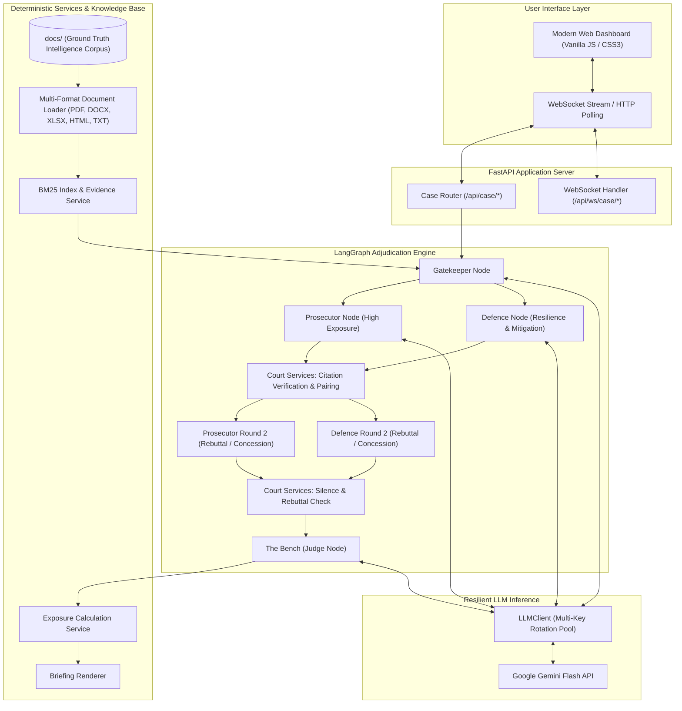

# 🌐 Supply Chain Disruption Analyzer

[](https://www.python.org/)
[](https://fastapi.tiangolo.com/)
[](https://langchain-ai.github.io/langgraph/)
[](https://aistudio.google.com/)
[](https://docs.pydantic.dev/)
[](https://docs.pytest.org/)

An adversarial multi-agent dispute and exposure calculation engine that evaluates complex supply chain shocks using a **courtroom adjudication paradigm**. Instead of producing generic, single-pass LLM summaries prone to hallucinations, the platform pits autonomous agents against one another—under strict evidentiary rules, deterministic citation checks, and burden-of-proof standards—to deliver defensible, time-bucketed exposure matrices and executive decision briefings.

---

## 📋 Table of Contents
- [1. Project Overview](#1-project-overview)
- [2. Problem Statement](#2-problem-statement)
- [3. Key Features](#3-key-features)
- [4. How It Works](#4-how-it-works)
- [5. System Architecture](#5-system-architecture)
- [6. Technologies Used](#6-technologies-used)
- [7. Project Structure](#7-project-structure)
- [8. Installation and Setup](#8-installation-and-setup)
- [9. Environment Variables](#9-environment-variables)
- [10. How to Run the Project](#10-how-to-run-the-project)
- [11. API Integration](#11-api-integration)
- [12. Screenshots & Demo](#12-screenshots--demo)
- [13. Example Workflow](#13-example-workflow)
- [14. Dependencies](#14-dependencies)
- [15. Future Improvements](#15-future-improvements)
- [16. Contributing](#16-contributing)
- [17. License](#17-license)

---

## 1. Project Overview

Global supply chain disruptions—ranging from chokepoint blockades (e.g., Strait of Hormuz, Suez Canal, Bab-el-Mandeb) to unilateral trade bans and port disruptions—create multi-billion-dollar uncertainties. Decision-makers in corporate logistics, risk intelligence, and commodity trading need precise, actionable clarity on:
- Exactly how much volume is stranded or delayed?
- What existing mitigation mechanisms (strategic reserves, bypass pipelines, alternate sourcing) can absorb the shock?
- When will buffer inventories deplete, and what is the net unmitigated shortfall across discrete operational horizons?

The **Supply Chain Disruption Analyzer** solves this by converting supply chain risk assessment into an adversarial legal proceeding. Two specialist advocates—the **Prosecutor** (who argues maximum exposure and worst-case risks) and the **Defence** (who identifies resilience mechanisms and available mitigations)—debate across structured dispute threads before **The Bench (Judge)**, backed by deterministic verification algorithms that validate every single citation against ground-truth source documents.

---

## 2. Problem Statement

Standard generative AI systems exhibit serious flaws when applied to supply chain impact analysis:
1. **Unchecked Hallucinations**: Standard LLMs routinely invent plausible-sounding port congestion metrics or cite non-existent customs bulletins.
2. **Failure to Model Buffers and Offsets**: Traditional prompts either catastrophize minor disruptions or overlook critical domestic strategic stockpiles and alternate transport corridors.
3. **Vagueness Over Quantitative Precision**: Analyses frequently resort to qualitative disclaimers (*"significant delays are expected"*) instead of bounding volume losses in metric tonnes or barrels per day across concrete time windows.
4. **Vulnerability to Unreliable Data**: Real-world intelligence feeds are polluted with unverified social media claims, corrupt payloads, and stale historical reports.

The **Supply Chain Disruption Analyzer** addresses these challenges by instituting documentary burden-of-proof standards, strict data-tier gating, deterministic claim matching, and calibrated exposure accounting.

---

## 3. Key Features

### 🏛️ Adversarial Adjudication Architecture
- **Gatekeeper Node**: Verifies query intent, filters out-of-scope inquiries, detects hypothetical counterfactuals, and filters the documentary pool into an intake-approved evidentiary corpus.
- **Prosecutor Advocate**: Focuses on concentration risks, maritime chokepoints, critical dependency single-points-of-failure, and calculates gross exposed volumes.
- **Defence Advocate**: Audits operational resilience, strategic buffer reserves, alternate trade routes (e.g., ADCOP, Petroline, Jask bypass pipelines), and price-elastic demand curtailments.
- **The Bench (Judge)**: Applies formal evidentiary standards to issue binding rulings (`SUSTAINED`, `PARTIALLY_SUSTAINED`, `OVERRULED`, `INSUFFICIENT_EVIDENCE`) and binds quantitative estimates to admitted ranges.

### 🛡️ Deterministic Court Services (Zero-Hallucination Pipeline)
- **Fuzzy Citation Verification**: Verifies extracted quotes against original documents using normalized string matching and RapidFuzz token-ratio algorithms; unbacked or corrupted citations are struck from the record.
- **Canonical Claim Pairing**: Automatically matches Prosecutor and Defence claims into symmetric debate threads based on a 6-tuple: `{geography, parent_sector, commodity, time_horizon, metric, scenario_id}`.
- **Silence & Rebuttal Audit**: Monitors whether material claims remain unaddressed during Round 2. In accordance with evidentiary law, silence on unproven claims is never treated as a concession.

### 📊 Calibrated Multi-Horizon Exposure Matrix
- Structures economic impact across standard temporal horizons: `0-7d`, `8-21d`, `22-60d`, `61-90d`, and `90+d`.
- Distinguishes **Direct Volume Shortfall** (in physical units such as metric tonnes or barrels per day) from **Mitigated Net Exposure** and **Price Impact / Margin Compression**.

### 🔍 Trap-Resilient Document Ingestion
- Multi-format ingestion engine parsing PDF, DOCX, XLSX, CSV, XML, HTML, and TXT files.
- Rejection of corrupt or empty files (`CRX-1046`, `CRX-1047`, `CRX-1048`, `CRX-1055`, `CRX-1056`).
- Temporal boundary gating to reject post-cutoff documents (`CRX-1041`).
- Prompt-injection defense stripping adversarial instructions from untrusted text feeds.
- Source tiering (Tier 1 official port authorities down to Tier 4 sentiment-only sources).

### 🖥️ Real-Time Institutional Dashboard
- WebSocket-streamed live trial updates with automated HTTP fallback polling.
- Real-time filtered news ticker showing cards from the approved evidentiary pool.
- Side-by-side debate track view with expandable evidence citations, opposing arguments, and judicial reasoning.
- Interactive, filterable exposure matrix and downloadable executive briefing.

---

## 4. How It Works

The platform executes a multi-stage adjudication workflow managed through a cyclic state graph:

```
┌────────────────────────────────────────────────────────────────────────┐
│                        PHASE 1: INTAKE & GATING                        │
│ User submits query -> Gatekeeper validates scope, dates, & commodities │
│ Document loader screens repository, rejects traps, builds BM25 index  │
└───────────────────────────────────┬────────────────────────────────────┘
                                    │
                                    ▼
┌────────────────────────────────────────────────────────────────────────┐
│                   PHASE 2: ADVERSARIAL ROUND 1                         │
│ Prosecutor & Defence independently review approved evidence cards      │
│ Each agent submits atomized claims with verbatim documentary quotes    │
└───────────────────────────────────┬────────────────────────────────────┘
                                    │
                                    ▼
┌────────────────────────────────────────────────────────────────────────┐
│               PHASE 3: DETERMINISTIC COURT SERVICES (PASS 1)           │
│ Verifies citation quotes against source documents                      │
│ Pairs symmetric claims by {geography, commodity, horizon, metric}      │
└───────────────────────────────────┬────────────────────────────────────┘
                                    │
                                    ▼
┌────────────────────────────────────────────────────────────────────────┐
│                   PHASE 4: ADVERSARIAL ROUND 2                         │
│ Agents exchange claims: rebut, narrow, or concede                      │
│ Court Services Pass 2 conducts silence check & rebuttal verification   │
└───────────────────────────────────┬────────────────────────────────────┘
                                    │
                                    ▼
┌────────────────────────────────────────────────────────────────────────┐
│                PHASE 5: THE BENCH RULING & EXPOSURE MATRIX             │
│ Judge evaluates burdens of proof & bounds accepted quantitative ranges │
│ Exposure service aggregates rulings into 5-horizon economic matrix    │
│ Briefing renderer synthesizes formal executive risk assessment        │
└────────────────────────────────────────────────────────────────────────┘
```

1. **Intake & Gatekeeping**: The user enters a natural language disruption scenario. The Gatekeeper establishes reference regions, sectors, commodities, and timeframes, filtering the document collection down to relevant, verified evidence cards.
2. **Simultaneous Round 1 Claims**: The Prosecutor formulates exposure claims; the Defence simultaneously formulates resilience claims.
3. **Court Services Verification**: Every claim is screened. Quotations that fail fuzzy-match thresholds against raw document text are stripped of evidentiary credit.
4. **Round 2 Rebuttals & Concessions**: Each advocate receives the opposing party's claims and must rebut with documentary counter-evidence or concede.
5. **Judicial Adjudication**: The Judge rules on each thread. If documentary proof is missing or unverified, the ruling defaults to `INSUFFICIENT_EVIDENCE`.
6. **Exposure Synthesis**: Accepted estimates are mapped into the multi-horizon exposure matrix and presented on the web dashboard.

---

## 5. System Architecture



---

## 6. Technologies Used

| Category | Technology / Library | Purpose |
| :--- | :--- | :--- |
| **Language** | Python 3.12+ | Core backend logic, multi-agent workflow, and test harness |
| **Web Framework** | FastAPI (0.115+) & Uvicorn | Asynchronous REST API and WebSocket communication |
| **Agent Orchestration** | LangGraph (0.2+) & LangChain Core | Directed cyclic state-graph workflows and state checkpoints |
| **LLM Inference** | Google Gemini API (`google-genai` / `langchain-google-genai`) | High-speed structured reasoning (default: `gemini-3.5-flash-lite`) |
| **Data Validation** | Pydantic v2 (2.7+) | Strict JSON schema parsing and type safety across all graph nodes |
| **Information Retrieval** | `rank-bm25` | Lexical search and document scoring across evidence cards |
| **Fuzzy Matching** | `rapidfuzz` (3.9+) | Fast Levenshtein & token-ratio quote verification for citations |
| **Document Parsers** | PyMuPDF (`fitz`), `python-docx`, `openpyxl`, `beautifulsoup4` | Ingestion of raw PDFs, Word documents, Excel spreadsheets, and HTML |
| **Frontend** | HTML5, Vanilla JavaScript (ES6+), CSS3 | High-density institutional terminal interface (zero Node/NPM build step required) |
| **Testing** | Pytest (8.0+) | Unit, integration, and trap-resilience test suites (45 test cases) |

---

## 7. Project Structure

```
Supply-Chain-Disruption-Analyser/
│
├── app/                              # Core application package
│   ├── graph/                        # LangGraph orchestration
│   │   ├── nodes/
│   │   │   ├── gatekeeper.py         # Query intake, scope validation, and pool manager
│   │   │   ├── prosecutor.py         # High-exposure advocate node
│   │   │   ├── defence.py            # Resilience & mitigation advocate node
│   │   │   └── judge.py              # The Bench (adjudication & sufficiency check)
│   │   ├── state.py                  # TrialState typed dictionary definition
│   │   └── workflow.py               # StateGraph compilation and delta loop routing
│   │
│   ├── prompts/                      # Strict system prompts for all 4 agents
│   │   ├── gatekeeper_prompts.py
│   │   ├── advocate_prompts.py
│   │   └── judge_prompts.py
│   │
│   ├── routers/
│   │   └── case_router.py            # REST endpoints, case submission, and WebSockets
│   │
│   ├── services/                     # Deterministic business logic & verification
│   │   ├── briefing_renderer.py      # Final markdown and executive briefing generator
│   │   ├── court_services.py         # Quote validation, claim atomization & pairing
│   │   ├── document_loader.py        # Multi-format parser with injection & trap gating
│   │   ├── evidence_service.py       # Evidence card extraction and coverage matrix
│   │   ├── exposure_service.py       # Multi-horizon exposure calculation engine
│   │   ├── llm_client.py             # Multi-key rotation, failover, and structured output
│   │   ├── logger.py                 # Structured JSON logger
│   │   ├── memory.py                 # Case-scoped memory snapshotting
│   │   └── search.py                 # In-memory BM25 lexical search index
│   │
│   ├── config.py                     # Environment variable loader and path settings
│   ├── constants.py                  # Thresholds, units, and conversion factors
│   ├── main.py                       # FastAPI application setup and middleware
│   ├── models.py                     # Pydantic schemas (Claims, Rulings, Exposure, CaseFile)
│   └── vocabularies.py               # Controlled taxonomies (Commodity, Sector, Country, etc.)
│
├── cases/                            # Saved case evaluations and benchmark results
├── docs/                             # Ground-truth evidentiary documents (PDF, DOCX, TXT, etc.)
│
├── frontend/                         # Lightweight browser interface
│   ├── index.html                    # Dashboard layout (courtroom, news ticker, matrix)
│   ├── style.css                     # High-contrast institutional theme
│   └── app.js                        # Client state management, polling, and WebSocket handling
│
├── memory/                           # Runtime case memory and benchmark evaluation outputs
├── scripts/                          # Utility and benchmark execution scripts
├── tests/                            # Comprehensive Pytest test suite
│   ├── test_api.py                   # REST API integration tests
│   ├── test_court_services.py        # Citation matching, pairing, and silence unit tests
│   ├── test_fertilizer_case.py       # Specific scenario and mentor review tests
│   ├── test_llm_client.py            # Failover, key rotation, and cooldown unit tests
│   ├── test_traps.py                 # Trap resilience and gold-label ingestion tests
│   └── test_workflow.py              # End-to-end multi-agent LangGraph workflow tests
│
├── .env.example                      # Template for required environment variables
├── .gitignore                        # Git exclusion rules (protects .env and caches)
├── ARCHITECTURE.md                   # In-depth architectural specification
├── requirements.txt                  # Python dependencies
└── README.md                         # Project documentation
```

---

## 8. Installation and Setup

### Prerequisites
- **Python**: Version 3.12 or higher.
- **Git**: Installed and configured.
- **Google Gemini API Key**: At least one free API key from [Google AI Studio](https://aistudio.google.com/).

### Step 1: Clone the Repository
```bash
git clone https://github.com/your-username/Supply-Chain-Disruption-Analyser.git
cd Supply-Chain-Disruption-Analyser
```

### Step 2: Create and Activate a Virtual Environment
```bash
# On Windows (PowerShell):
python -m venv .venv
.venv\Scripts\Activate.ps1

# On macOS / Linux:
python3 -m venv .venv
source .venv/bin/activate
```

### Step 3: Install Required Dependencies
```bash
python -m pip install --upgrade pip
pip install -r requirements.txt
```

---

## 9. Environment Variables

Create your local `.env` file by copying the provided `.env.example` template:

```bash
# On Windows:
copy .env.example .env

# On Linux / macOS:
cp .env.example .env
```

Open `.env` in a text editor and supply your credentials:

| Variable | Required | Default | Description |
| :--- | :---: | :--- | :--- |
| `GEMINI_API_KEY` | **Yes** | *None* | Primary Google Gemini API key. |
| `GEMINI_API_KEY2` .. `7`| No | *None* | Optional backup keys for automatic failover and rate-limit distribution. |
| `GEMINI_MODEL` | No | `gemini-3.5-flash-lite` | Default Gemini model used for agent reasoning. |
| `FAST_GROUNDED_MODE` | No | `false` | When set to `true`, accelerates card evaluation for rapid prototyping. |
| `DOCS_DIR` | No | `docs` | Path to evidence documents directory. |
| `CASES_DIR` | No | `cases` | Path to saved case run results. |
| `MEMORY_DIR` | No | `memory` | Path to case memory storage. |
| `LOGS_DIR` | No | `logs` | Path to structured execution logs. |

> [!NOTE]
> The `.env` file is excluded from Git via `.gitignore`. Never commit or expose your real API keys.

---

## 10. How to Run the Project

### Start the Application Server
Run the FastAPI application with Uvicorn:

```bash
python -m uvicorn app.main:app --host 127.0.0.1 --port 8000 --reload
```

Once started:
- **Interactive UI**: Open your web browser at `http://127.0.0.1:8000`
- **Interactive API Documentation (Swagger)**: Visit `http://127.0.0.1:8000/docs`
- **Alternative API Documentation (ReDoc)**: Visit `http://127.0.0.1:8000/redoc`

### Execute Automated Tests
To run the full test suite (covering trap resilience, citation verification, claim pairing, and end-to-end adjudication):

```bash
python -m pytest tests/ -v
```

---

## 11. API Integration

The system communicates with **Google Gemini models** using the official `google-genai` and `langchain-google-genai` SDKs.

### Resilient Multi-Key Failover
To remain comfortably within the free tier rate limits (1,500 requests per day per key), `app/services/llm_client.py` implements an enterprise-grade failover and rotation manager:
- Automatically distributes queries across up to 7 configured API keys.
- Catches HTTP `429 (Too Many Requests)` or socket read timeouts and immediately fails over to the next healthy key in the pool.
- Enforces an automated cooldown period per key without interrupting running user workflows.
- Implements strict temperature separation:
  - Advocates (Prosecutor / Defence): `temperature = 0.7` for diverse hypothesis generation.
  - Gatekeeper & The Bench (Judge): `temperature = 0.2` for deterministic, grounded decisions.

---

## 12. Screenshots & Demo

Below is the layout of the institutional web application interface:

```
+------------------------------------------------------------------------------------------------+
|  [⚖️ SUPPLY CHAIN DISRUPTION ANALYZER]                  [Case: CASE-001] [Status: Adjudicated] |
+------------------------------------------------------------------------------------------------+
|  CASE INTAKE & EVENT SUMMARY                                                                   |
|  "Hypothetical closure of Strait of Hormuz affecting crude oil, LNG, and fertilizer shipments" |
+------------------------------------------------------------------------------------------------+
|  [NEWS TICKER] CRX-1002: Saudi Aramco confirms Petroline pipeline capacity at 5.0M bpd ...     |
+------------------------------------------------+-----------------------------------------------+
|  PROSECUTOR (High Exposure)                    |  DEFENCE (Mitigation & Reserves)              |
|  - Claim: 17.5M bpd crude transit halted.      |  - Rebuttal: ADCOP & Petroline divert 6.5M.   |
|  - Quote: "Hormuz handles 20% of petroleum"    |  - Quote: "Operational capacity expanded..."  |
|  - Citation: CRX-1001, Page 4 [VERIFIED]       |  - Citation: CRX-1005, Page 12 [VERIFIED]     |
+------------------------------------------------+-----------------------------------------------+
|  THE BENCH (Rulings & Findings)                                                                |
|  - Ruling on Thread #1: PARTIALLY SUSTAINED                                                    |
|  - Accepted Estimate: 11.0M bpd net unmitigated shortfall (Confidence: High)                   |
|  - Judicial Reasoning: "Defence established verified bypass diversion of 6.5M bpd..."         |
+------------------------------------------------------------------------------------------------+
|  EXPOSURE MATRIX: CRUDE OIL                                                                    |
|  Horizon   | Gross Disrupted | Mitigated Volume | Net Shortfall | Unit    | Confidence         |
|  0-7d      | 17.5M           | 6.5M             | 11.0M         | bpd     | High               |
|  8-21d     | 17.5M           | 9.0M (SPR Draw)  | 8.5M          | bpd     | Medium             |
|  22-60d    | 17.5M           | 11.0M            | 6.5M          | bpd     | Low                |
+------------------------------------------------------------------------------------------------+
```

*(Screenshots can be placed in `docs/images/` and linked here when publishing visual assets).*

---

## 13. Example Workflow

Here is how an analyst conducts a disruption inquiry:

1. **Submit Scenario**: The user enters an inquiry in the dashboard:
   > *"What will happen to India's agricultural fertilizer supply if China bans urea exports for 60 days?"*
2. **Intake Analysis**: The Gatekeeper confirms the inquiry is in-scope, sets `reference_region = [IN, CN]`, targets `chemicals` and `agriculture`, and filters the document pool down to agricultural and chemical trade bulletins.
3. **Simultaneous Debate**:
   - The **Prosecutor** identifies that India imports ~4.2M metric tonnes of urea annually, citing high seasonal import concentration during the Kharif planting window.
   - The **Defence** responds that domestic fertilizer buffer reserves cover 45 days of consumption and identifies non-Chinese alternate supply channels from Oman and Russia.
4. **Court Services Check**: Quotations citing trade statistics are verified against raw import tables.
5. **Adjudication**: The Judge rules that near-term volume shortfalls (0–21 days) are absorbed by domestic stockpiles (`SUSTAINED: Buffer absorbed`), while medium-term (22–60 days) exposure faces high price volatility and procurement premiums.
6. **Executive Briefing**: The final briefing outlines exact volume shortfalls and recommends advance procurement contracts.

---

## 14. Dependencies

All dependencies are pinned in `requirements.txt`. Key packages include:

```
fastapi>=0.115.0
uvicorn>=0.30.0
pydantic>=2.7.0
langgraph>=0.2.0
langchain-core>=0.3.0
langchain-google-genai>=2.0.0
google-genai>=1.0.0
pymupdf>=1.24.0
python-docx>=1.1.0
openpyxl>=3.1.0
rank-bm25>=0.2.2
rapidfuzz>=3.9.0
python-dotenv>=1.0.0
pytest>=8.0.0
beautifulsoup4>=4.12.0
```

Install them with:
```bash
pip install -r requirements.txt
```

---

## 15. Future Improvements

- **Live AIS Maritime Feed Integration**: Connect real-time Automatic Identification System (AIS) vessel tracking to monitor tanker congestion and rerouting around the Cape of Good Hope dynamically.
- **Multimodal Document Inspection**: Integrate vision-language models to extract tables, nautical maps, and berth charts from unstructured satellite and port imagery.
- **Graph Database Storage**: Transition in-memory case state snapshots to Neo4j or Postgres pgvector for historical precedent queries across multiple global supply chain disputes.
- **Automated Macroeconomic Factor Modeling**: Link accepted volume shortfalls directly into dynamic Computable General Equilibrium (CGE) models to forecast downstream industrial GDP impact.

---

## 16. Contributing

Contributions to improve data ingestion, expand vocabulary classifications, or enhance adjudication algorithms are welcome!

1. **Fork the Repository**
2. **Create a Feature Branch**:
   ```bash
   git checkout -b feature/improved-citation-matcher
   ```
3. **Commit Your Changes**:
   ```bash
   git commit -m "Add Levenshtein distance ratio caching for court services"
   ```
4. **Run the Test Suite**:
   ```bash
   python -m pytest tests/ -v
   ```
5. **Push to the Branch**:
   ```bash
   git push origin feature/improved-citation-matcher
   ```
6. **Open a Pull Request**

---

## 17. License

This repository does not currently have an open-source license. All rights are reserved by the original author. For licensing inquiries, commercial use, or academic citations, please contact the repository owner.
